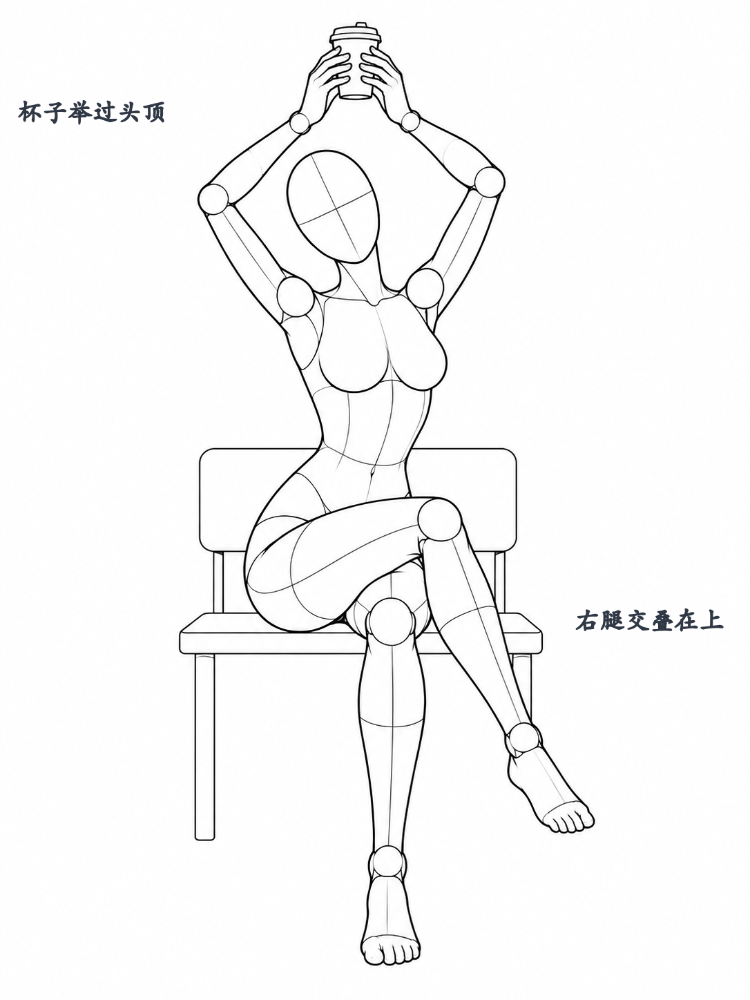
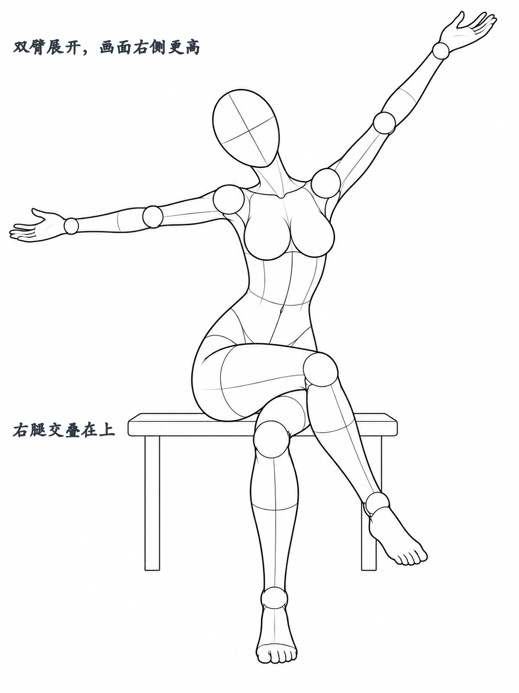
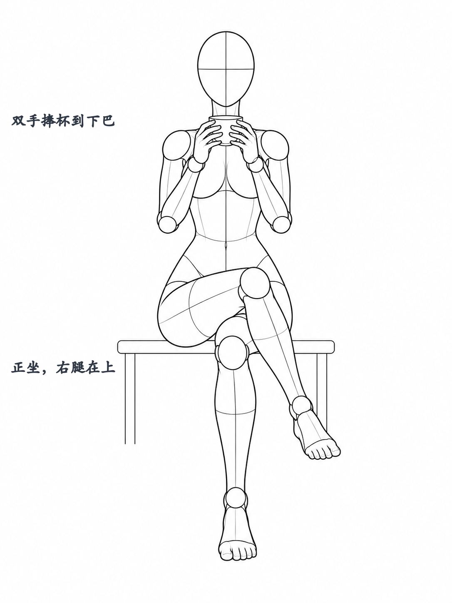
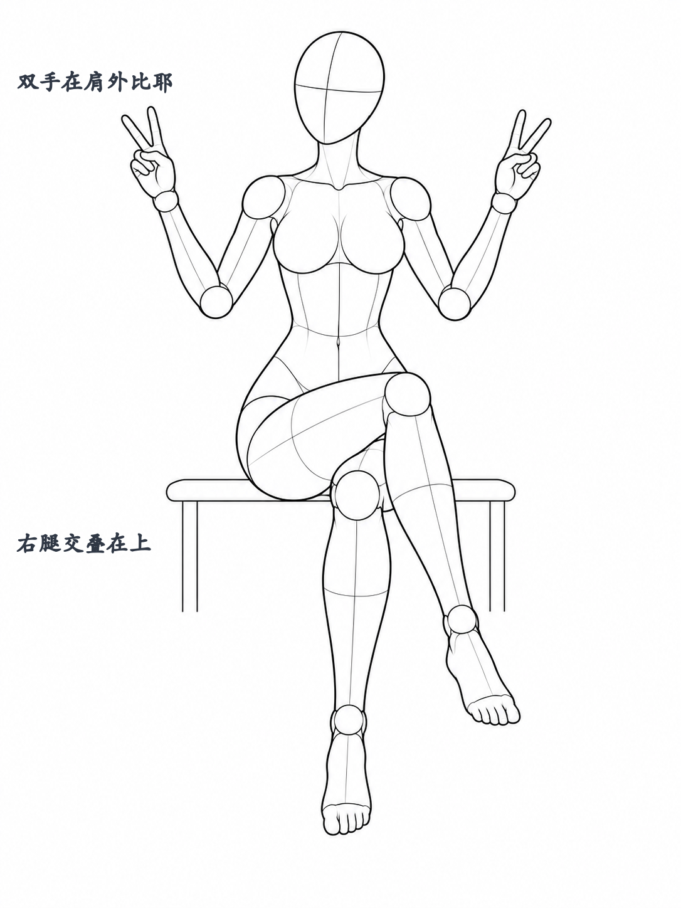
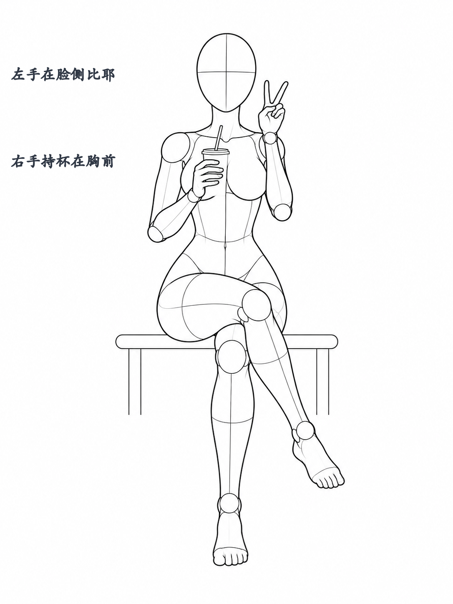
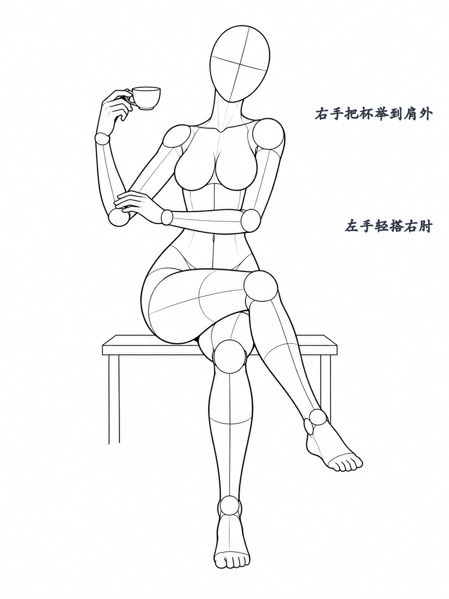
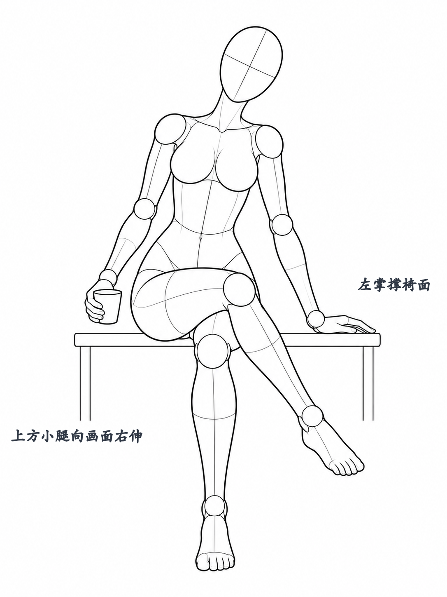
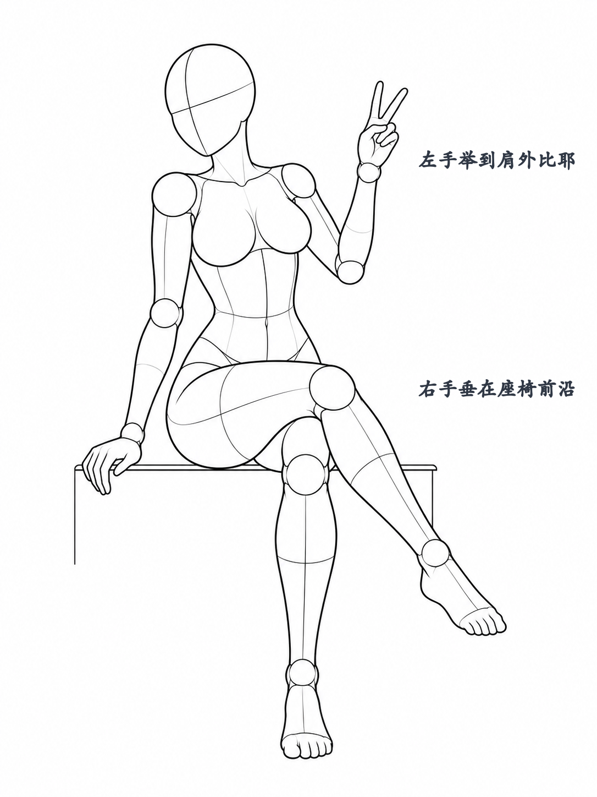
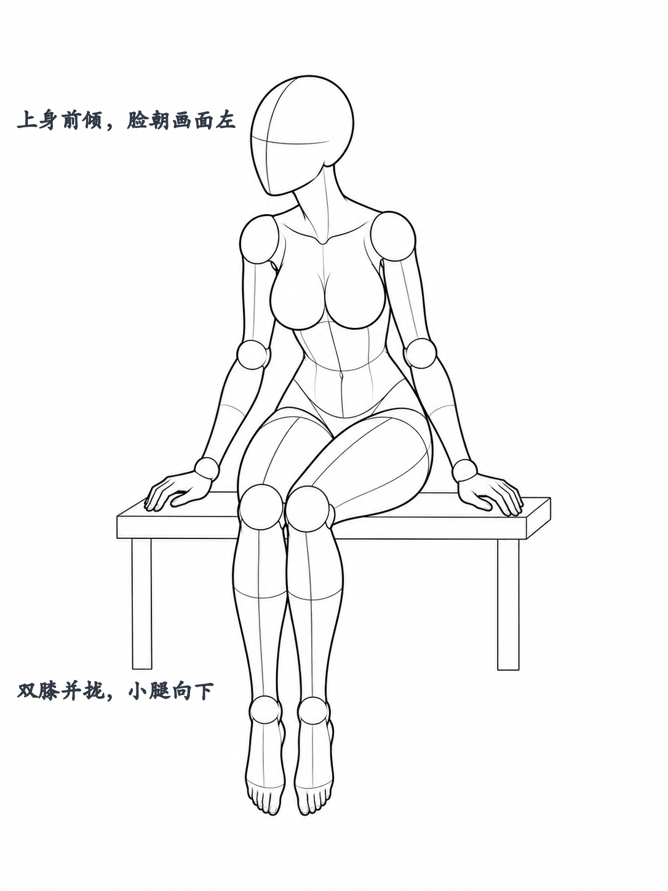

# 坐姿

收录和转写按[人物姿态参考表](../人物姿态参考表.md)。

## 坐姿-001 交腿侧扭坐、双手举杯过头

臀部坐稳在有靠背的长椅前缘。右大腿斜过左大腿上方，右膝在画面右前且高于左膝，右小腿落在画面右并稍离地，左小腿近竖直向下。胸腰微拧，头向画面左倾，脸朝镜头。双肘高抬向左右打开，双前臂在头顶上方收拢，两手扶同一只带盖小杯；杯底高于头顶，腕部合拢而肘部不合拢。

**图上短标注**

- 杯子举过头顶
- 右腿交叠在上

## 坐姿-002 交腿坐、双臂错高展开

臀部坐在长椅前部。右大腿横跨左大腿，右膝移到画面右前，右脚离地，左小腿近垂直。上身向画面左侧轻倾，头继续向同侧歪、脸朝镜头。双臂同时张开，人物右臂伸向画面左，接近水平，人物左臂向画面右斜上伸，左手高过头顶，双肘伸展，手腕自然舒展。

**图上短标注**

- 双臂展开，画面右侧更高
- 右腿交叠在上

## 坐姿-003 交腿正坐、双手捧杯到下巴

臀部承重坐在长椅前缘，胸口正对镜头且躯干直立。右大腿跨在左大腿上，右膝偏画面右，左小腿近竖直落向地，右脚在画面右侧略高。双肘向下靠近胸廓两侧，前臂抬起，两只手同时围住胸口上方的一只小杯，杯在下巴正下。头保持端正、目光看镜头。

**图上短标注**

- 双手捧杯到下巴
- 正坐，右腿在上

## 坐姿-004 交腿坐、双手外展比耶

臀部坐在长椅前缘，胸口朝前，右大腿交在左大腿上，右膝偏画面右且比左膝高，两小腿自然错开下垂。双上臂向外下打开，肘接近腰肋高度并弯曲，双前臂从肘向两侧斜上伸，双手各比耶，手略低于头且在肩线外。头近正面，视线稍偏画面左。

**图上短标注**

- 双手在肩外比耶
- 右腿交叠在上

## 坐姿-005 交腿坐、胸前持杯并在脸侧比耶

臀部坐长椅前缘，躯干近正面。右大腿压在左大腿上，右膝落画面右前、右脚略悬，左小腿垂向地面。右肘靠右侧躯干，右前臂抬到胸前，右手握一只带吸管的小杯。左肘弯曲、左前臂近竖直，左手在画面右侧脸颊外做向上的比耶。头正对镜头。

**图上短标注**

- 右手持杯在胸前
- 左手在脸侧比耶

## 坐姿-006 交腿坐、单手侧举杯另一手托肘

坐在长椅前缘，右大腿斜跨左大腿并把右膝送到画面右前，右脚略抬，左小腿垂下。上身轻转，头向画面右略倾，脸转回镜头。右上臂向画面左伸出，右肘弯起，右前臂抬起让小杯位于右肩外侧；左前臂横过胸腹，左手轻搭右肘内侧，和右手分开。

**图上短标注**

- 右手把杯举到肩外
- 左手轻搭右肘

## 坐姿-007 交腿侧伸、单手撑椅单手持杯

臀部坐在长椅前缘，右大腿搭在左大腿上；右膝偏画面右，右小腿从膝向画面右下斜伸，脚离地，左小腿竖直落向地面。上身略向画面右侧倾，头同向明显倾，脸朝镜头。左掌落在画面右的座面上，手指向外，右肘略屈，右手在画面左的胯外较低处握小杯。

**图上短标注**

- 左掌撑椅面
- 上方小腿向画面右伸

## 坐姿-008 交腿侧倚、低手扶椅高手比耶

臀部坐在长椅前缘，右大腿横跨左大腿，右脚在画面右，左小腿接近竖直。上身斜倚向画面左、肩线倾斜。人物右臂朝画面左下伸，右手落在臀侧座椅前沿，指尖在前沿附近下垂。人物左肘弯曲，左手在画面右侧肩外向上比耶。头略倾，脸和视线都朝画面左侧。

**图上短标注**

- 右手垂在座椅前沿
- 左手举到肩外比耶

## 坐姿-009 并膝前倾坐、双手分落座面

坐在长椅前缘，臀部承重，上半身从髋部轻轻前倾，脸转向画面左侧。双膝并拢向前偏下，两小腿平行、近竖直，脚尖向下，两只脚处在接近同高的位置，与座面分开。右臂向画面左下自然放，右手在右臀旁座面附近；左手落在左臀旁的座面上，手指松开。两手在身体两侧，肘不抬高。

**图上短标注**

- 双膝并拢，小腿向下
- 上身前倾，脸朝画面左
