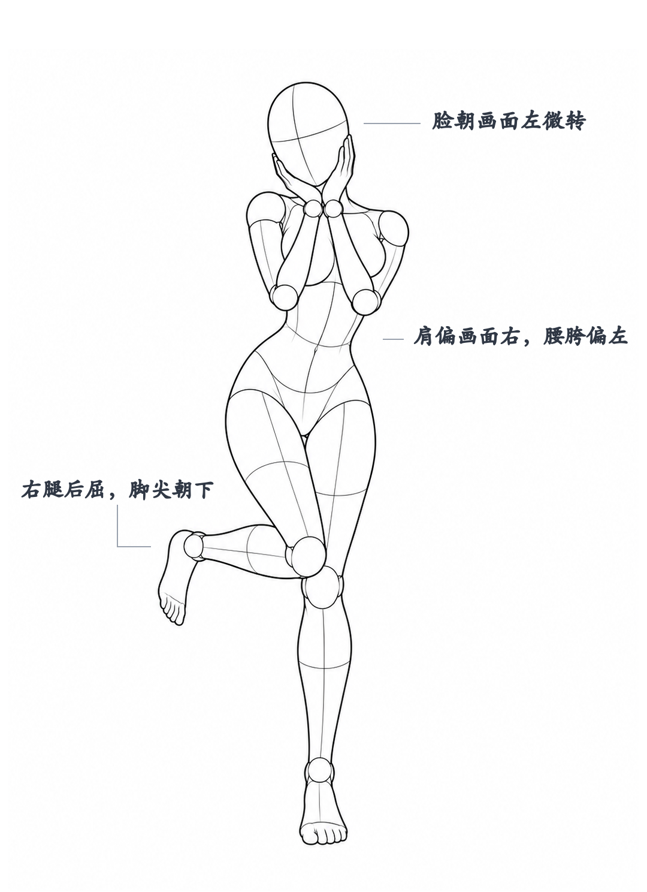
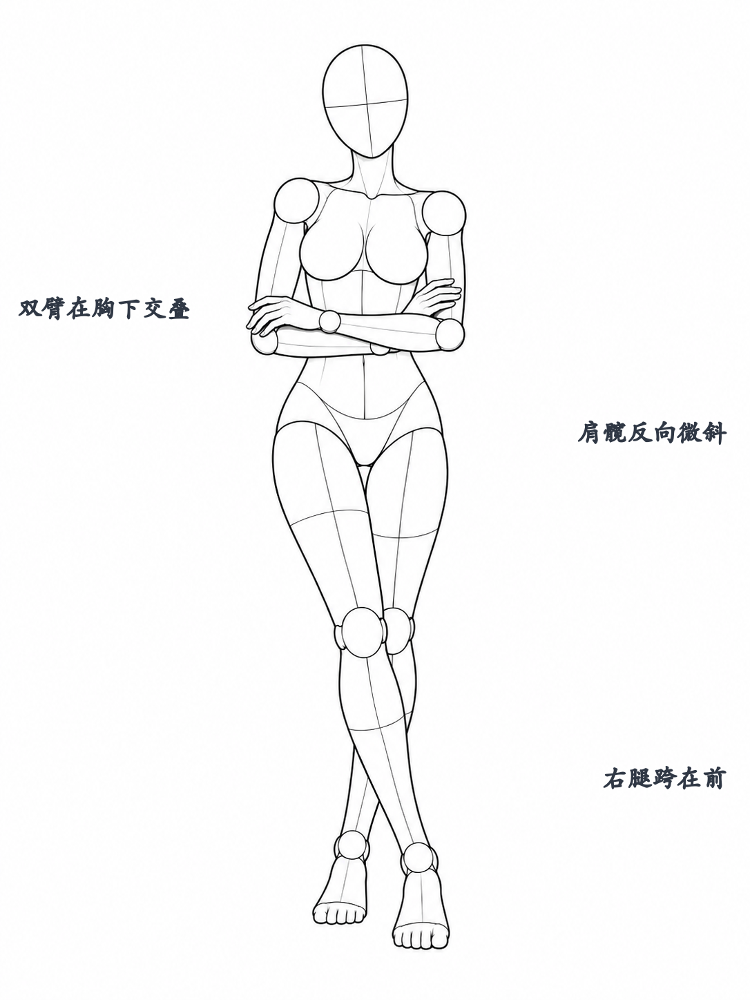
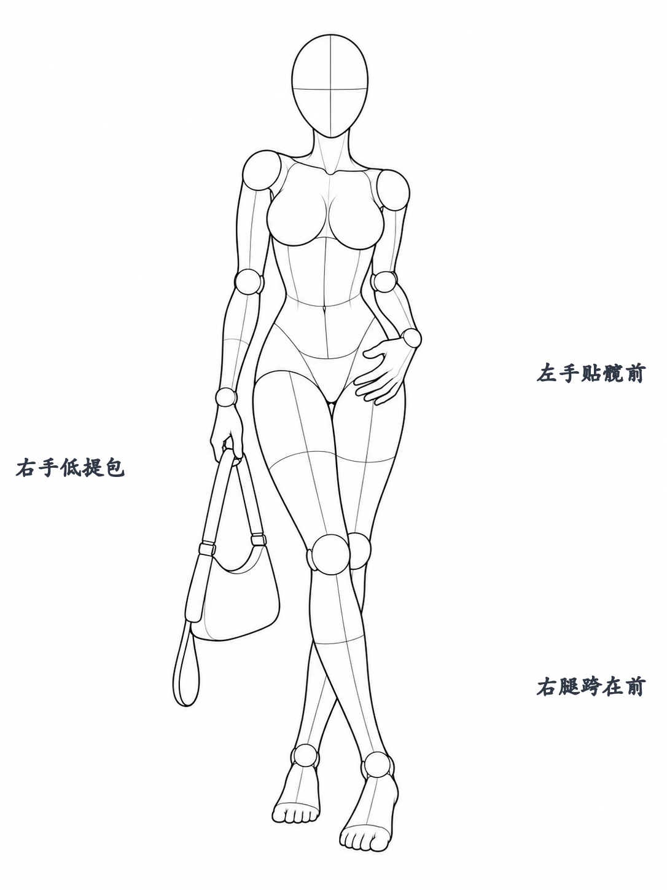
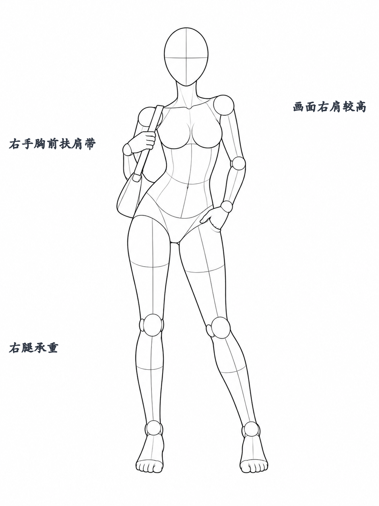
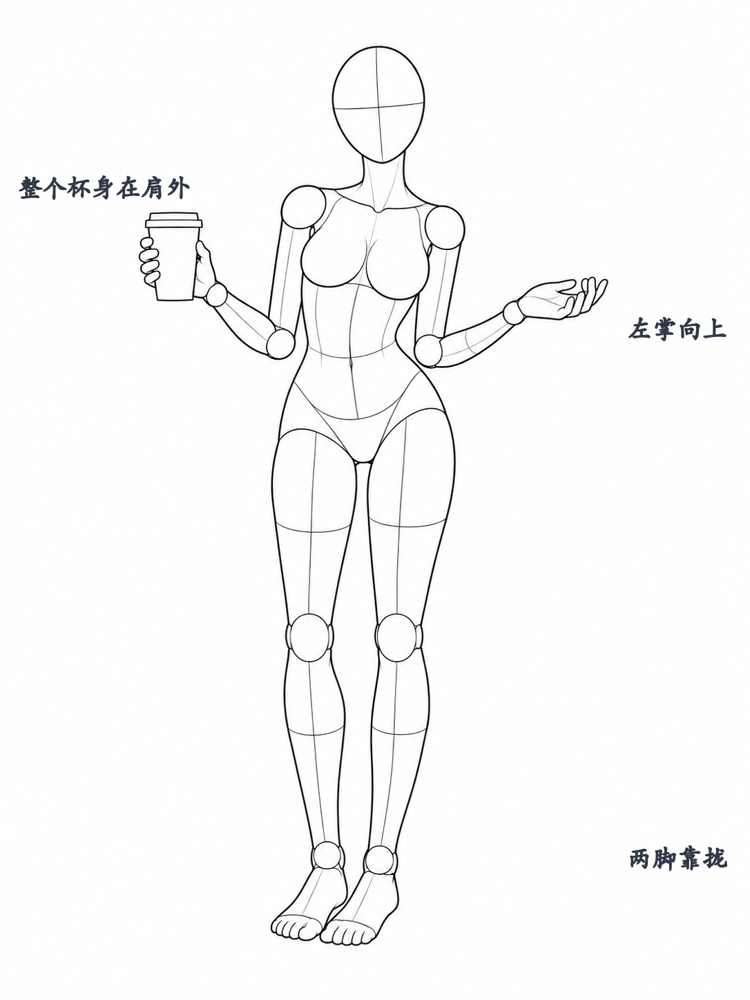
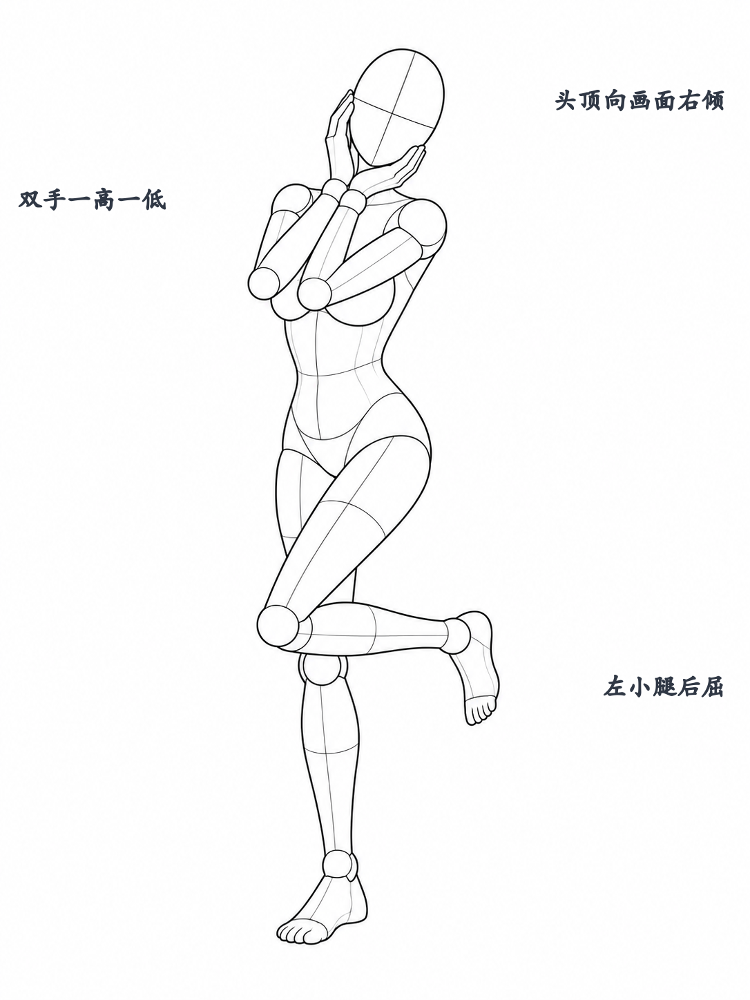

# 站姿

收录和转写按[人物姿态参考表](../人物姿态参考表.md)。

## 站姿-001 普通正面站姿

身体正对镜头，头和躯干直立，双肩与骨盆各自接近水平。双脚约髋宽，双脚全掌着地、平均承重，脚尖大致朝前。双臂自然垂在身侧，手指放松，手臂与躯干之间留窄缝。

*双脚全掌着地，肩胯平正。*

## 站姿-002 双手捧脸、单腿后屈

骨盆大致朝镜头，胸廓略微转斜。双肩中心偏向画面右侧，腰胯偏向画面左侧，画面左肩略高、右肩略低。腰在胸廓与骨盆之间轻微侧弯并扭转，一侧腰线收紧，另一侧拉长。

头顶向画面左侧轻倾，脸同向微转，下巴微收。两手掌心朝内，分别轻托同侧脸颊下缘，指尖朝上，画面右侧的指尖略高。双腕靠近下巴，前臂呈窄 V 形，双肘朝前下方收拢。

左腿承重，左脚全掌着地，脚尖大致朝前。右大腿斜向内收，右膝在左膝前方略高处。右小腿向后弯曲，在画面中近水平地伸向左侧，右脚离地，脚尖自然朝下。

**图上短标注**

- 脸朝画面左微转
- 肩偏画面右，腰胯偏左
- 右腿后屈，脚尖朝下

## 站姿-003 抱臂交叉站

以近正面机位取全身。脸基本朝镜头，下巴自然，头顶只有很小的侧倾。画面左肩略高，画面右髋略高，肩线和髋线轻微反向倾斜。两肘在胸下、上腹前，贴近身体两侧。人物左前臂在外层，从画面右侧的肘近水平横到画面左侧，左手松搭右肘上方。右手指贴住左上臂下段，位置略高于左手。两膝自然前后错开，右膝在前并略偏画面左，右小腿从此斜向画面右下方，跨在左小腿前。右脚落在画面右前，左脚落在画面左后，两脚着地，脚尖基本朝镜头。

**图上短标注**

- 双臂在胸下交叠
- 肩髋反向微斜
- 右腿跨在前

## 站姿-004 单手提包交叉站

近正面站立，脸朝镜头、下巴微收。画面左肩略高，画面右髋略高，胸廓和骨盆之间有很小的侧弯。画面左侧的右臂贴身下垂，右手在大腿上段外侧握包带。包带从手下垂，包体底边略低于膝盖，整个包在右腿外侧。画面右侧的左肘靠近腰侧，左手拇指勾在髋前袋口，另外四指在髋前横斜向身体中线，贴住大腿上段。右膝比左膝略向前，右小腿斜跨左小腿，右脚落在画面右前方，左脚在画面左后方，两脚全掌着地。

**图上短标注**

- 右手低提包
- 左手贴髋前
- 右腿跨在前

## 站姿-005 扶包带分腿站

脸基本正对镜头，胸廓与骨盆都接近正面。重心在画面左侧的右脚，右髋明显移到右脚上方。原图画面右肩比左肩略高，画面左髋比右髋略高。肩线和髋线向相反方向斜，腰侧弯，胸廓中心比骨盆中心稍偏画面右。右肘靠近肋侧，右手在胸前偏外、明显低于右肩的位置扶住肩带，包体紧贴右侧腰。左肘顺身侧下垂微弯，左手停在同侧髋前袋口。两脚之间约一个肩宽。右腿近竖直，左腿斜向画面右侧伸出、膝微弯，两脚掌都贴地。

**图上短标注**

- 右手胸前扶肩带
- 画面右肩较高
- 右腿承重

## 站姿-006 单手端杯、另一手侧托

近正面。胸廓略斜，画面左肩稍高，画面右侧的髋点较高，胸廓与骨盆之间留下轻微侧弯。两上臂向下靠近身体，两肘约在腰部两侧。人物右前臂从右肘向画面左上方伸开，整个杯身都落在右肩轮廓的外侧，手指握住杯侧，杯口平整、杯身直立。左前臂向画面右外侧斜抬，左掌朝上略朝外，手指轻弯，掌面低于杯口。双脚靠近，两只鞋尖一起略朝画面左，双膝放松，腿部轮廓基本平行。

**图上短标注**

- 整个杯身在肩外
- 左掌向上
- 两脚靠拢

## 站姿-007 双手插兜交叉站

近正面，脸朝镜头，头顶微向画面左侧偏。画面右肩略高，上身中心比骨盆稍偏画面右。双上臂自然垂下，肘靠拢身侧。画面右侧的左上臂和前臂外沿接近竖直，靠近躯干和髋侧。双腕贴近同侧髋前，双手分别插入袋口，袋口呈小斜弧，手指大部分被遮住。左大腿从画面右侧斜向内收，左腿在前跨向画面左下方。两膝前后错开，小腿在膝下呈交叉。左脚落于画面左前、脚尖略外开，右脚在画面右后、脚尖更接近正面。两脚着地。

**图上短标注**

- 画面右肩较高
- 双手插袋
- 左腿跨在前

## 站姿-008 双臂斜下展开、交叉抬脚

近正面平视，头顶向画面左侧轻倾，脸稍朝左并回看镜头。画面右肩略高。两臂从肩向外斜下，手腕落在髋部附近。手腕向上回折，使两手接近水平，掌面朝下，十指分别朝画面左右外侧。每只手腕离同侧肩的水平距离小于两者的垂直落差，手臂自然下放。右脚全掌着地承重，腿接近竖直。左大腿斜跨到右腿前方，左膝靠近右膝高度、偏画面左。左小腿从膝盖斜向画面右下方伸出，与承重腿交叠。左脚悬在右小腿中段附近，脚尖朝下。

**图上短标注**

- 腕折，手近水平
- 双臂斜下
- 左脚悬空

## 站姿-009 侧身捧脸、单腿后屈

胸廓和骨盆朝画面左侧转成三分之四侧面，胸腹的前侧仍清楚可见。画面右侧的左肩更靠近镜头，近侧左上臂斜横过胸前，两肘朝画面左下方收近。脸从侧转的躯干方向轻转回镜头。头顶明显向画面右侧倾，下巴偏画面左下，脸的横向中轴呈画面左高、右低。画面左侧的右手竖贴脸颊，指尖接近太阳穴。画面右侧的左掌从较低处斜托住下颌，两手腕靠近。右脚全掌承重，脚尖略朝画面左。左大腿从前侧斜跨，左膝靠近承重膝的高度、位于其前方且偏画面左。左小腿向后弯，画面里近水平伸向右侧，左脚尖朝下。

**图上短标注**

- 头顶向画面右倾
- 双手一高一低
- 左小腿后屈

## 站姿-010 双臂举成高 V、交叉站

脸基本正对镜头，胸廓向上伸展。两臂从肩向外斜上举成高 V。两肘接近伸直，从正面看约在眉眼高度，两只手腕都明显高过头顶，原图约高三分之一头长。手腕向外翻，手掌接近水平并朝上，两手手指分别伸向外侧。骨盆接近正面并微斜。人物左腿从画面右侧斜跨到左侧，位于右腿前方，左脚落在画面左前，脚尖稍外开。右脚落在画面右后，脚尖接近正面。两脚着地，交叉轮廓集中在膝下。

**图上短标注**

- 双腕高过头顶
- 双掌平展向外
- 左腿跨在前
