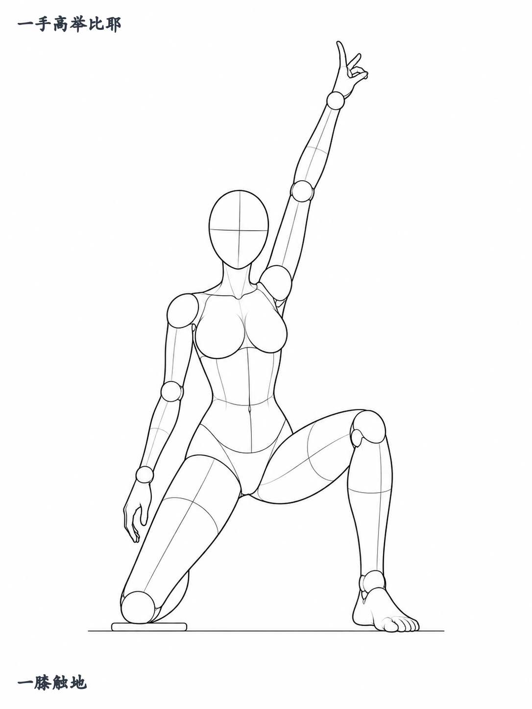
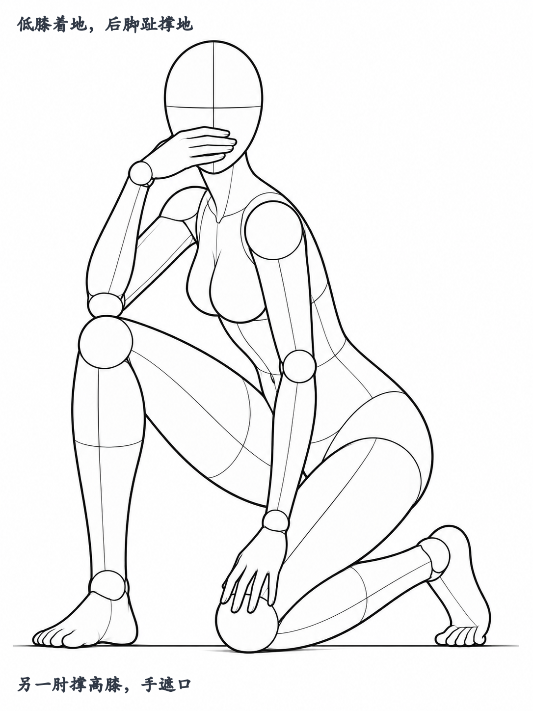

# 跪姿

收录和转写按[人物姿态参考表](../人物姿态参考表.md)。

## 跪姿-001 单膝着地、单手高举比耶

一侧膝盖着地、另一脚踩地，前膝屈起，背直，一手举高，一手下放。

**图上短标注**

- 一手高举比耶
- 一膝触地

## 跪姿-002 侧身半跪、一手遮口一手撑低膝

侧向画面左的半跪姿，头转回镜头。近腿弯折贴地，近膝触地，近小腿折向纸面右后，脚跟抬起，前脚掌和前趾抵地。近侧手从肩顺下，指尖自然张开按在落地的膝上方。较远的腿在侧前方屈起，膝盖明显高于近膝，远脚全掌踩地。远肘实落在高膝上，前臂向上，四指横在空白头部的下半区域前方，留出上半轮廓。髋向后坐低，胸向高膝方向前倾。

**图上短标注**

- 低膝着地，后脚趾撑地
- 另一肘撑高膝，手遮口
